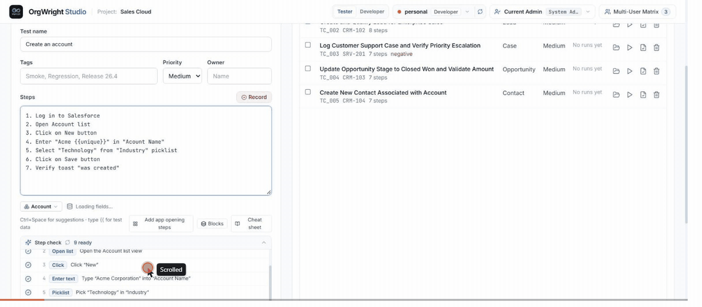

# Orgwright

**Write Salesforce tests in plain English, get real Playwright code.**

[](https://github.com/krishnakumar11oct1995-star/orgwright/actions/workflows/ci.yml)
[](LICENSE)



*A typo'd field name is flagged before the run. The run pauses on the failing step with the browser still open, the step is fixed, and the test finishes green. Recorded against a free Developer Edition org.*

You type what a tester would write in a test case:

```text
Open Account list
Click on New button
Enter "Acme {{unique}}" in "Account Name"
Select "Technology" from "Industry" picklist
Click on Save button
Verify toast "was created"
```

and Orgwright writes a normal Playwright spec you can read, commit and run anywhere:

```ts
// Step 3: Enter "Acme {{unique}}" in "Account Name"
await StreamHelper.runStep(page, "Enter \"Acme {{unique}}\" in \"Account Name\"", async () => {
  const input = page.getByRole('textbox', { name: /Account Name/i })
    .or(page.getByLabel(/Account Name/i))
    .first();
  await input.waitFor({ state: 'visible', timeout: 15000 });
  await input.fill(OrgwrightData.resolve("Acme {{unique}}"));
  await input.press('Tab');
  await LightningHelpers.waitForLightningReady(page);
});

// Step 4: Select "Technology" from "Industry" picklist
await StreamHelper.runStep(page, "Select \"Technology\" from \"Industry\" picklist", async () => {
  await LightningHelpers.selectCombobox(page, "Industry", "Technology");
});
```

No proprietary runner, no record-and-playback blob. If you stop using Orgwright tomorrow, your tests still work.

## Why I built it

Testing Salesforce Lightning with plain Playwright is painful. Spinners that come and go, comboboxes that aren't real `<select>`s, toasts that disappear before you can assert on them, Shadow DOM, list views, related lists, record pages that render in three passes. Every team ends up writing the same helpers, and the people who know the business flows best (manual testers, admins, BAs) can't write the tests.

Orgwright is my attempt to fix both: one battle-tested set of Lightning helpers, and a step language that people who aren't developers can actually write.

## What it does

- **Plain-English steps.** Navigation, App Launcher, list views, record pages, fields, picklists, lookups, checkboxes, related lists, path stages, record types, owner changes, approvals, lead conversion, global search and more. Typos like "clciking app auncher" get corrected.
- **Knows your org.** It reads objects, fields and picklist values from your org through the Salesforce CLI and warns you *before* a run when a field doesn't exist or "Closed" isn't a valid Status.
- **Pause and repair.** When a step fails in a headed run, the test pauses with the browser still open on the failing page. You fix the step in the Studio and carry on from there, instead of rerunning a ten-minute test from the top.
- **Fails loudly.** A step Orgwright doesn't understand, a missing tab or a missing field fails the test with a clear message. It never quietly skips something and reports green.
- **Test data that doesn't collide.** `{{unique}}`, `{{today+7}}`, remembered values (`Remember record Id as caseId`, then `Open record {{caseId}}`), records created through the API and cleaned up afterwards, and data-driven runs from a table of rows.
- **Studio.** A local web app to write and check steps, run tests with a live view of the browser, reuse step blocks, browse ~100 starter templates, export to Excel and schedule a nightly suite with a Teams summary.
- **Personas.** Run the same test as different users with Salesforce "Login As".

## Quick start

You need [Node.js 20+](https://nodejs.org), [pnpm](https://pnpm.io/installation), Google Chrome and the [Salesforce CLI](https://developer.salesforce.com/tools/salesforcecli).

The easiest org to try it on is a free [Developer Edition](https://developer.salesforce.com/signup). It comes with Accounts, Contacts, Opportunities and Cases, which is all the examples use.

```bash
git clone --recurse-submodules https://github.com/krishnakumar11oct1995-star/orgwright.git
cd orgwright
npm run setup
```

Log the Salesforce CLI into your org once. Orgwright uses that session, so there is no password in a file and MFA isn't a problem:

```bash
sf org login web --alias sandboxOrg
```

Copy `.env.example` to `.env` and set `SF_LOGIN_URL` to your org's address. `sf org display --target-org sandboxOrg` prints it as "Instance Url". You can leave the username and password empty when you use the CLI login. Then start the Studio:

```bash
npm run studio
```

Open http://localhost:5173, connect your org in the welcome wizard and pick a starter test.

Prefer the command line? Generated specs live in `tests/generated/` and run like any Playwright test:

```bash
npm run test:regression
```

## Project layout

```text
orgwright/
  apps/studio/          Studio UI (React + Vite) and its local API server
  packages/resolver/    plain-English step parser and org-aware checks
  packages/codegen/     turns resolved steps into Playwright specs
  packages/introspector reads objects, fields and picklists via the sf CLI
  packages/runner/      runs Playwright and streams results back
  packages/core/        shared types
utils/
  lightning-helpers.ts  the Lightning helpers every generated test uses
tests/
  definitions/          test cases as JSON (steps, metadata, last result)
  generated/            the Playwright specs Orgwright wrote
tests-orgwright/        helper tests against saved Lightning pages (no org needed)
```

## Running the project's own tests

None of these need a Salesforce org:

```bash
npm run test:unit      # step parser and code generator
npm run test:helpers   # Lightning helpers against saved HTML pages
```

## Status

This is young software. It's been used against real orgs, but expect rough edges, especially with heavily customised Lightning pages. A few things I know about:

- The Studio's API server is meant for your own machine. Don't expose it on a shared network.
- `Run Apex` is parsed but not implemented yet; those steps fail on purpose.
- Some org lookups block the API server while the `sf` CLI runs, so the Studio can feel stuck for a few seconds on first load.

Bug reports with the step text and a screenshot are the most useful thing you can send.

## Contributing

Issues and pull requests are welcome. See [CONTRIBUTING.md](CONTRIBUTING.md). Issues tagged [good first issue](https://github.com/krishnakumar11oct1995-star/orgwright/labels/good%20first%20issue) are a nice place to start.

## Credits

The spec audit in the Studio follows the rules from [qa-skills](https://github.com/petrkindlmann/qa-skills) by Petr Kindlmann (MIT), included as a git submodule.

## License

[MIT](LICENSE)
